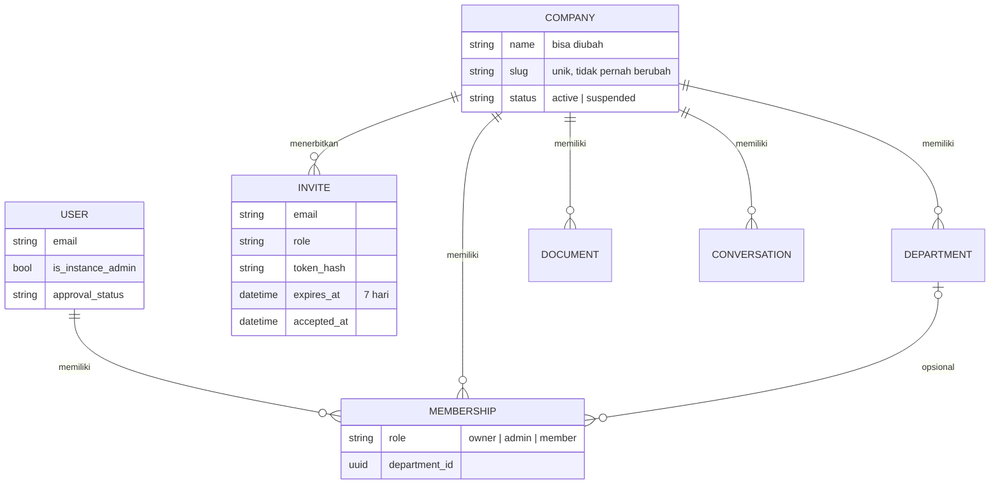
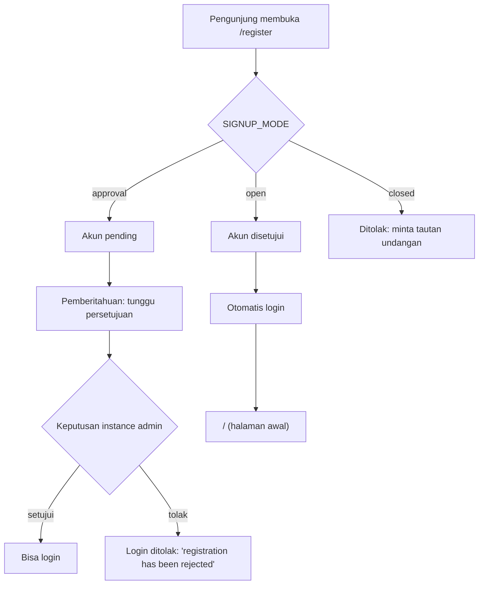
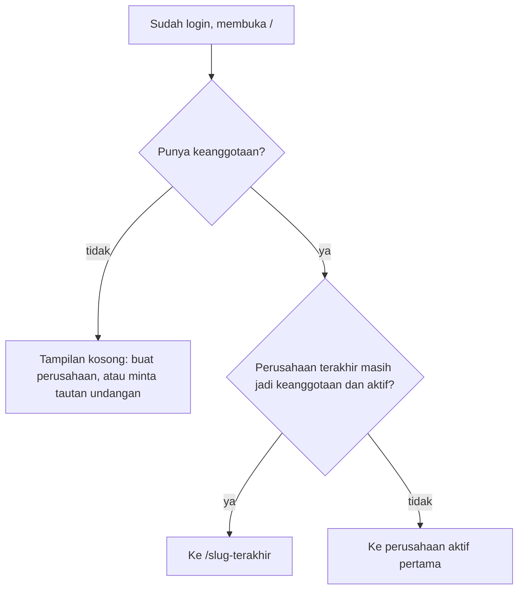
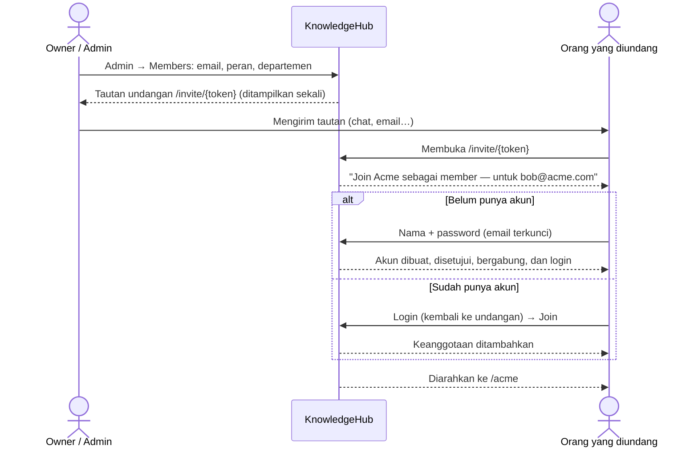
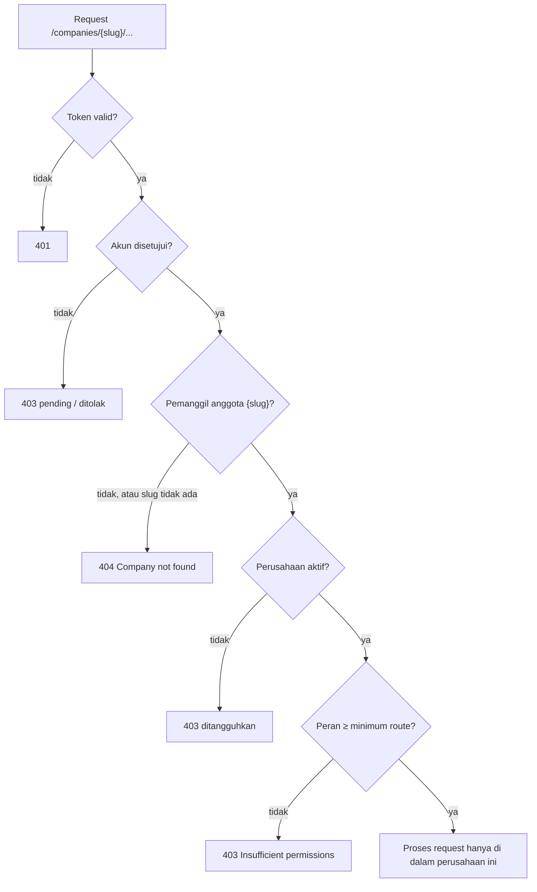

# Alur akses multi-tenant

> 🇬🇧 English version: [multi-tenant-flow.md](multi-tenant-flow.md)

Cara kerja akun, perusahaan, peran, dan undangan setelah perubahan RBAC multi-tenant ([#121](https://github.com/nandes007/knowledgehub-ai/issues/121)). Detail endpoint ada di [api-contract.md](api-contract.md).

## Konsep utama

- **Akun bersifat global.** Seseorang cukup mendaftar sekali dengan satu email dan bisa bergabung ke beberapa perusahaan.
- **Keanggotaan (membership) menghubungkan akun ke perusahaan.** Setiap keanggotaan punya peran sendiri (`owner`, `admin`, `member`) dan departemen (opsional).
- **Perusahaan ada di URL.** Web: `/acme/knowledge`. API: `/companies/acme/documents`. Dua perusahaan bisa dibuka di dua tab sekaligus.
- **Instance admin mengelola platform.** Ia mengelola akun dan perusahaan, tetapi tidak bisa membaca dokumen atau chat perusahaan mana pun kecuali ia juga punya keanggotaan biasa di perusahaan itu.



## 1. Pendaftaran

Pendaftaran **hanya membuat akun**. Pengaturan `SIGNUP_MODE` menentukan langkah berikutnya.

| `SIGNUP_MODE` | Tanpa undangan | Dengan tautan undangan |
| --- | --- | --- |
| `open` (bawaan) | Akun langsung disetujui dan langsung login | Disetujui dan langsung bergabung ke perusahaan |
| `approval` | Akun berstatus `pending` sampai disetujui instance admin | Disetujui dan bergabung (undangan menjadi jaminannya) |
| `closed` | Ditolak: "Signup is closed. Ask a company admin for an invite link." | Disetujui dan bergabung |



Saat login, akun yang masih pending atau ditolak mendapat pesan yang jelas, bukan "password salah". Pencocokan email tidak membedakan huruf besar/kecil.

## 2. Halaman awal setelah login



- Perusahaan terakhir yang dibuka diingat per browser.
- Perusahaan yang ditangguhkan (suspended) hanya memblokir dirinya sendiri; pengguna tetap bisa pindah ke perusahaan lainnya.
- Sidebar punya **pengalih perusahaan** yang menampilkan semua keanggotaan, ditambah **Create company…** dan, khusus instance admin, **Instance admin**.

## 3. Membuat perusahaan

1. Pengguna yang sudah login membuka tampilan kosong atau `/new`, lalu mengisi nama.
2. Perusahaan mendapat slug yang aman untuk URL dari namanya (contoh `Acme Corp` → `acme-corp`; ditambah `-2`, `-3` … jika sudah dipakai; kata khusus seperti `login`, `instance`, `new` dilewati).
3. Pembuatnya menjadi **owner**.
4. Mengganti nama hanya mengubah nama tampilan; slug dan semua tautan tetap sama.

Jika `MAX_COMPANIES_PER_USER` diatur, seorang pengguna tidak bisa **memiliki (sebagai owner)** lebih dari jumlah itu.

## 4. Mengundang orang

Tidak perlu server email: pengundang menyalin tautan lalu mengirimkannya sendiri.



Aturan undangan:

- **Terikat pada email.** Hanya akun dengan email yang diundang yang bisa memakainya; tautan yang diteruskan ke orang lain gagal dengan pesan "sent to a different email address".
- **Sekali pakai, kedaluwarsa setelah 7 hari.** Undangan baru untuk email yang sama menggantikan undangan lama.
- **Hanya owner yang bisa mengundang admin.** Admin hanya bisa mengundang member.
- **Sudah menjadi anggota?** Membuat atau menerima undangan akan mengembalikan pesan "already a member" yang jelas.
- Undangan yang belum dipakai tampil di Admin → Members dan bisa dicabut (revoke).
- Tetap berfungsi walaupun `SIGNUP_MODE=closed`.

## 5. Peran dan hak aksesnya

| Aksi | Member | Admin | Owner |
| --- | :---: | :---: | :---: |
| Chat; melihat dokumen seluruh perusahaan + dokumen departemennya sendiri | ✅ | ✅ | ✅ |
| Melihat semua dokumen di perusahaan | | ✅ | ✅ |
| Mengunggah / menghapus dokumen | | ✅ | ✅ |
| Mengelola departemen, melihat statistik perusahaan | | ✅ | ✅ |
| Mengundang **member**; mengubah departemen member; mengeluarkan member | | ✅ | ✅ |
| Mengundang admin; menaikkan / menurunkan peran; mengeluarkan admin | | | ✅ |
| Mengalihkan kepemilikan; mengganti nama / menghapus perusahaan | | | ✅ |
| Keluar dari perusahaan | ✅ | ✅ | hanya setelah mengalihkan kepemilikan |

Aturan wajib:

- **Tidak ada yang bisa mengubah perannya sendiri.**
- **Admin tidak pernah bisa bertindak atas admin lain atau owner.**
- **Setiap perusahaan punya tepat satu owner.** Setelah kepemilikan dialihkan, owner sebelumnya menjadi admin.
- **Mengeluarkan member** tetap menyimpan dokumen yang pernah ia unggah dan menghapus percakapannya di perusahaan itu.
- **Perubahan berlaku pada request berikutnya.** Peran selalu dibaca dari database, jadi tidak perlu menunggu sesi kedaluwarsa.

## 6. Setiap request ke perusahaan

Setiap route yang terikat perusahaan mengambil perusahaannya dari satu tempat: slug di path plus keanggotaan pemanggil.



Yang bukan anggota mendapat **404, bukan 403**, supaya slug perusahaan tidak bisa ditebak-tebak. Instance admin pun mendapat 404 yang sama kecuali ia punya keanggotaan.

## 7. Chat dan retrieval

1. Pertanyaan dikirim ke `/companies/{slug}/chat`.
2. Retrieval **selalu** difilter dengan id perusahaan saat ini (tidak ada jalur tanpa filter).
3. Member hanya mendapat potongan dari dokumen seluruh perusahaan dan dokumen departemennya sendiri. Owner dan admin mendapat semua dokumen di perusahaan.
4. Percakapan milik satu pengguna di satu perusahaan, jadi konteks antarperusahaan tidak pernah tercampur.

## 8. Administrasi instance

Instance admin bekerja di `/instance`, di luar perusahaan mana pun.

- **Users:** melihat semua akun atau hanya yang pending; menyetujui, menolak, menghapus. Pengguna yang masih menjadi owner sebuah perusahaan tidak bisa dihapus sampai kepemilikannya dialihkan atau perusahaannya dihapus.
- **Companies:** daftar beserta jumlah anggota, tangguhkan, aktifkan kembali, hapus.
- **Stats:** penggunaan dan estimasi biaya seluruh instance.

Instance admin pertama dibuat lewat command line:

```bash
docker compose exec backend python -m app.cli create-instance-admin \
  --email admin@example.com --password 'ganti-dengan-password-yang-aman'
```

## 9. Batasan untuk instance publik

Semua bernilai bawaan `0` (tanpa batas). Masing-masing mengembalikan pesan yang menyebutkan batas mana yang tercapai.

| Pengaturan | Dicek saat | Yang dihitung |
| --- | --- | --- |
| `MAX_DOCUMENTS_PER_COMPANY` | Mengunggah dokumen | Jumlah dokumen di perusahaan |
| `MAX_MESSAGES_PER_COMPANY_PER_DAY` | Mengirim pesan chat | Pesan pengguna di perusahaan dalam 24 jam terakhir |
| `MAX_COMPANIES_PER_USER` | Membuat perusahaan | Jumlah perusahaan yang dimiliki pengguna |

Rekomendasi pengaturan:

- **Demo publik:** `SIGNUP_MODE=open` dengan batasan kecil.
- **Self-hosted:** `SIGNUP_MODE=closed` ditambah tautan undangan, batasan dibiarkan `0`.

## 10. Upgrade instalasi yang sudah ada

Migrasi `0005_memberships` mengubah data di tempat, tanpa kehilangan data:

1. Setiap perusahaan mendapat slug yang dibuat dari namanya.
2. Superadmin lama menjadi instance admin.
3. Perusahaan, peran, dan departemen setiap pengguna dipindahkan menjadi keanggotaan.
4. Admin yang paling awal dibuat di setiap perusahaan menjadi owner-nya.
5. Kolom perusahaan, peran, dan departemen lama dihapus dari tabel users.

Dokumen, departemen, percakapan, dan vektor tetap menyimpan referensi perusahaannya, jadi tidak perlu indexing ulang.
