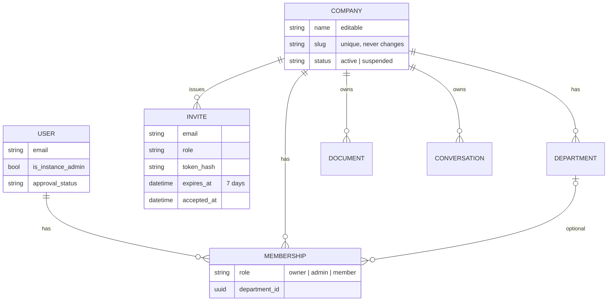
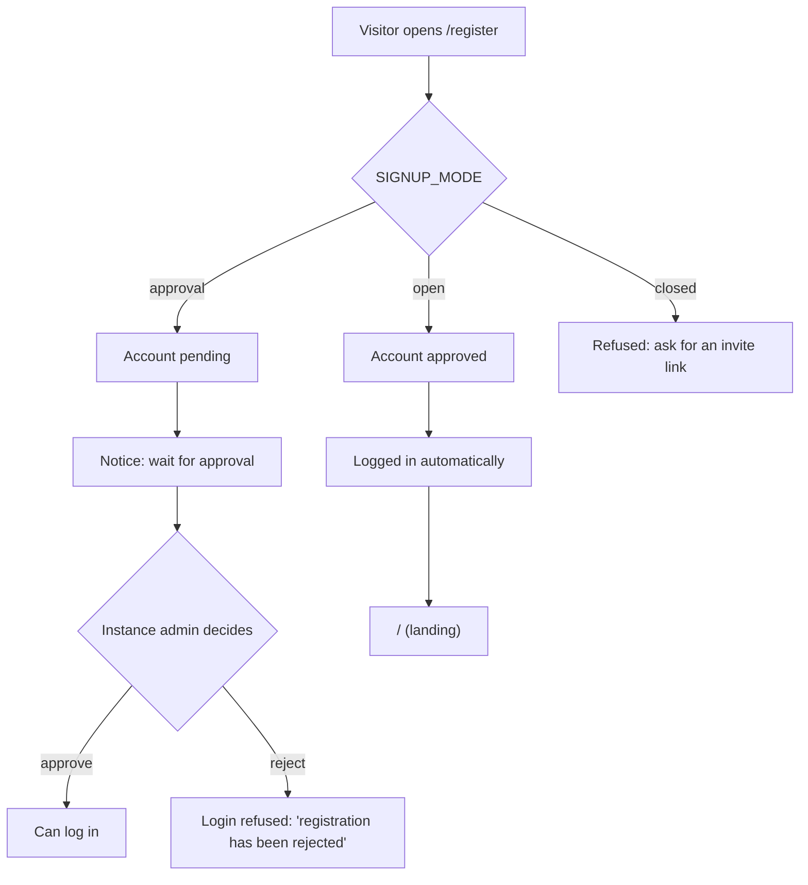
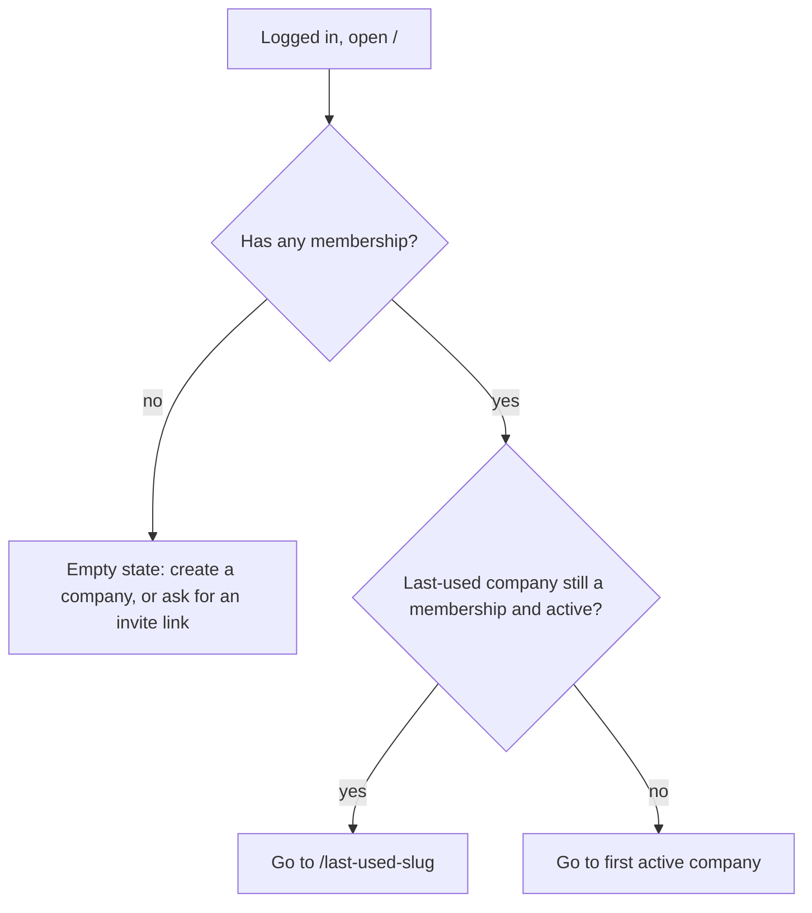
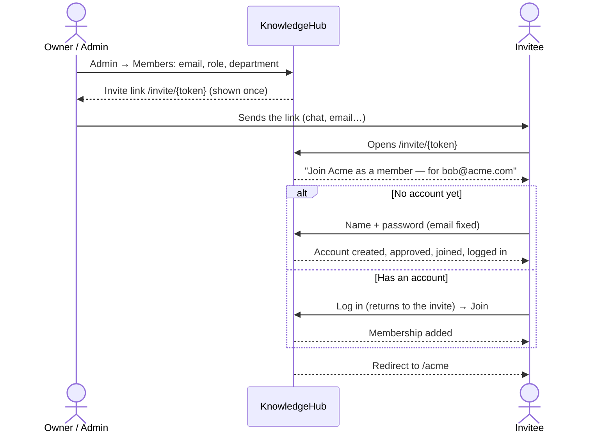
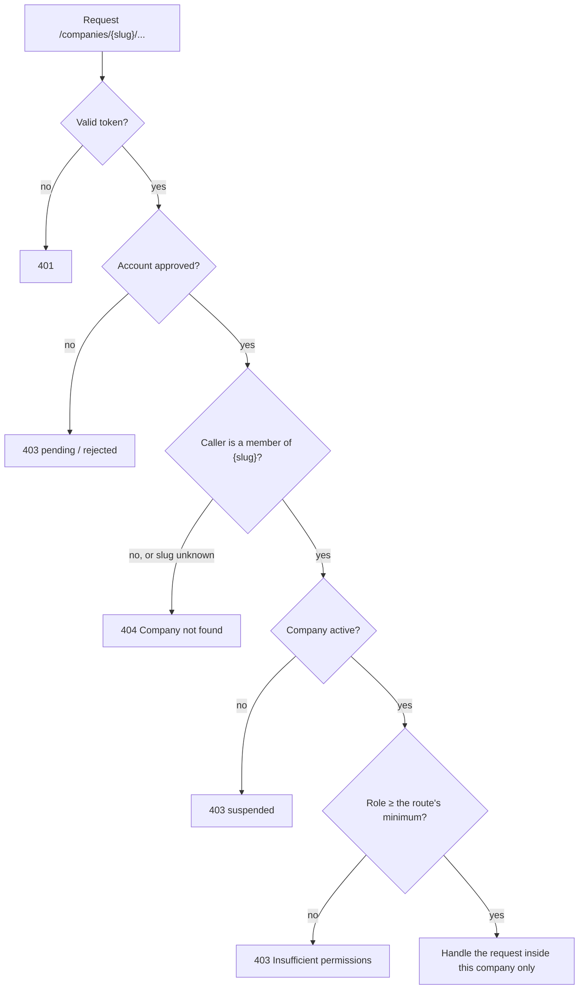

# Multi-tenant access flow

> 🇮🇩 Versi Bahasa Indonesia: [multi-tenant-flow.id.md](multi-tenant-flow.id.md)

How accounts, companies, roles and invites work after the multi-tenant RBAC change ([#121](https://github.com/nandes007/knowledgehub-ai/issues/121)). Endpoint shapes are in [api-contract.md](api-contract.md).

## Core ideas

- **An account is global.** A person signs up once with one email and can belong to several companies.
- **A membership links an account to a company.** Each membership has its own role (`owner`, `admin`, `member`) and optional department.
- **The company is in the URL.** Web: `/acme/knowledge`. API: `/companies/acme/documents`. Two companies can be open in two tabs.
- **The instance admin runs the platform.** It manages accounts and companies, but cannot read any company's documents or chats unless it also holds an ordinary membership.



## 1. Sign up

Registration creates **only an account**. The `SIGNUP_MODE` setting decides what happens next.

| `SIGNUP_MODE` | Without an invite | With an invite link |
| --- | --- | --- |
| `open` (default) | Account approved; logged in at once | Approved and joined to the company |
| `approval` | Account `pending` until an instance admin approves | Approved and joined (the invite vouches for it) |
| `closed` | Refused: "Signup is closed. Ask a company admin for an invite link." | Approved and joined |



At login, a pending or rejected account gets a clear message instead of "invalid password". Emails are matched without regard to case.

## 2. Landing after login



- The last-used company is remembered per browser.
- A suspended company only blocks itself; the user can still switch to their other companies.
- The sidebar has a **company switcher** listing every membership, plus **Create company…** and, for instance admins, **Instance admin**.

## 3. Create a company

1. A logged-in user opens the empty state or `/new` and enters a name.
2. The company gets a URL-safe slug from the name (for example `Acme Corp` → `acme-corp`; `-2`, `-3` … if taken; reserved words such as `login`, `instance`, `new` are skipped).
3. The creator becomes its **owner**.
4. Renaming later changes only the display name; the slug and every link stay the same.

If `MAX_COMPANIES_PER_USER` is set, a user cannot **own** more than that many companies.

## 4. Invite someone

No email server is needed: the inviter copies a link and sends it themselves.



Invite rules:

- **Bound to the email.** Only an account with the invited email can use it; a forwarded link fails with "sent to a different email address".
- **Single-use, expires after 7 days.** A new invite for the same email replaces the old one.
- **Only the owner can invite admins.** Admins invite members only.
- **Already a member?** Creating or accepting the invite returns a clear "already a member" message.
- Pending invites are listed on Admin → Members and can be revoked.
- Works even when `SIGNUP_MODE=closed`.

## 5. Roles and what they allow

| Action | Member | Admin | Owner |
| --- | :---: | :---: | :---: |
| Chat; see company-wide docs + own department's docs | ✅ | ✅ | ✅ |
| See every document in the company | | ✅ | ✅ |
| Upload / delete documents | | ✅ | ✅ |
| Manage departments, view company stats | | ✅ | ✅ |
| Invite **members**; change a member's department; remove members | | ✅ | ✅ |
| Invite admins; promote / demote; remove admins | | | ✅ |
| Transfer ownership; rename / delete the company | | | ✅ |
| Leave the company | ✅ | ✅ | only after transferring ownership |

Hard rules:

- **Nobody changes their own role.**
- **An admin can never act on another admin or the owner.**
- **Every company has exactly one owner.** Transferring makes the previous owner an admin.
- **Removing a member** keeps the documents they uploaded and deletes their conversations in that company.
- **Changes apply on the next request.** Roles are read from the database every time, so there's no waiting for a session to expire.

## 6. Every company request

Every company-scoped route gets its company from one place: the slug in the path plus the caller's membership.



Non-members get **404, not 403**, so company slugs can't be probed. Instance admins get the same 404 unless they hold a membership.

## 7. Chat and retrieval

1. A question is sent to `/companies/{slug}/chat`.
2. Retrieval **always** filters by the current company's id (there is no unfiltered path).
3. Members only get chunks from company-wide documents and their own department's documents. Owners and admins get every document in the company.
4. Conversations belong to one user in one company, so contexts never mix between companies.

## 8. Instance administration

The instance admin works at `/instance`, outside any company.

- **Users:** list everyone or only pending accounts; approve, reject, delete. You can't delete a user who owns a company until they transfer ownership or the company is deleted.
- **Companies:** list with member counts, suspend, reactivate, delete.
- **Stats:** instance-wide usage and estimated cost.

The first instance admin is created from the command line:

```bash
docker compose exec backend python -m app.cli create-instance-admin \
  --email admin@example.com --password 'replace-with-a-secure-password'
```

## 9. Limits for a public instance

All default to `0` (unlimited). Each returns a message that names the limit.

| Setting | Checked when | Counts |
| --- | --- | --- |
| `MAX_DOCUMENTS_PER_COMPANY` | Uploading a document | Documents in the company |
| `MAX_MESSAGES_PER_COMPANY_PER_DAY` | Sending a chat message | Company's user messages in the last 24 hours |
| `MAX_COMPANIES_PER_USER` | Creating a company | Companies the user owns |

Suggested setups:

- **Public demo:** `SIGNUP_MODE=open` with small caps.
- **Self-hosted:** `SIGNUP_MODE=closed` plus invite links, caps left at `0`.

## 10. Upgrading an existing install

Migration `0005_memberships` converts the data in place, with no data loss:

1. Each company gets a slug generated from its name.
2. Former superadmins become instance admins.
3. Each user's company, role and department becomes a membership.
4. The earliest-created admin of each company becomes its owner.
5. The old company, role and department columns are dropped from users.

Documents, departments, conversations and vectors keep their company reference, so nothing needs re-indexing.
